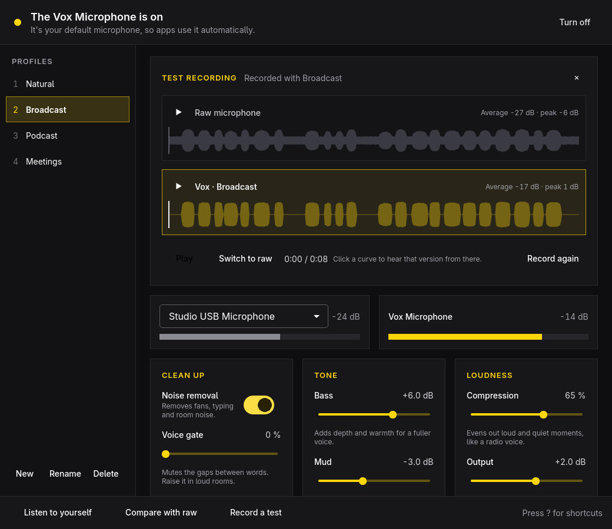

# Vox



Vox makes your microphone sound better in every app. It runs your voice
through noise removal, a tone EQ, a compressor and a limiter, and offers the
result to the whole desktop as the **Vox Microphone**. Pick it in Teams, Meet,
Discord, OBS or your browser, or make it the default microphone so every app
uses it without asking.

Profiles hold the settings. Switching profiles happens live, so the Vox
Microphone never drops out of a call.

## Tray

Vox sits in the system tray, starting at login. The icon is a microphone in
the theme's accent while the Vox Microphone is on, grey and crossed out while
it's off, and amber while comparing with the raw microphone; hover it to see
the profile and whether Vox is the default microphone. Its menu turns Vox on
or off, switches profiles in one click, and makes Vox the default microphone.
Click the icon to open or hide the window, middle-click it to turn Vox on or
off. Closing the window, or Q, leaves Vox in the tray.

Omarchy's bar puts new tray icons behind its arrow; right-click the arrow and
pin Vox to keep it in sight. To stop the tray starting at login, copy
`/etc/xdg/autostart/vox-tray.desktop` to `~/.config/autostart/` and add
`Hidden=true`.

## Test recording

Press **Record a test** (or T), say a few sentences, and press it again. Vox
records your raw microphone and the Vox Microphone at the same moment, so both
takes hold exactly the same words, and lines them up to
take out Vox's own processing delay. The player draws both as level curves
with one playhead: click a curve to hear that version from that point, or
press Tab while it plays to switch between raw and Vox without losing your
place. Recordings stay in memory and stop after 30 seconds.

## How it works

PipeWire runs a filter chain as the systemd user service `vox.service`:

```text
your mic → RNNoise → rumble filter → bass → mud → presence → air → compressor → limiter → Vox Microphone
```

The service starts with PipeWire at login and keeps running when the window
is closed. Every setting is a control on the running graph, so the window and
`vox use` change it in place with `pw-cli`, without restarting anything.

| Control | What it does |
| --- | --- |
| Noise removal | RNNoise removes fans, typing and room noise |
| Voice gate | Mutes the gaps between words (RNNoise voice detection) |
| Rumble filter | High-pass filter against desk, traffic and air-conditioning rumble |
| Bass | Low shelf at 120 Hz for a deeper, warmer voice |
| Mud | Bell at 300 Hz; cut it to sound less boxy |
| Presence | Bell at 4 kHz; brings words forward |
| Air | High shelf at 10 kHz |
| Compression | One knob for threshold, ratio and make-up gain |
| Output | Gain into a limiter that stops at -1 dBFS |

The presets are Natural, Broadcast, Podcast and Meetings. Edit them, or press
N to make a new profile from the current one.

## Keyboard

| Key | Action |
| --- | --- |
| Space | Compare with your raw microphone |
| L | Listen to yourself (use headphones) |
| T | Record a test, or stop recording |
| P | Play or pause the test |
| Tab | Switch between raw and Vox in the test |
| Esc | Close the test |
| O | Turn the Vox Microphone on or off |
| D | Make Vox the default microphone |
| 1 to 9 | Switch profile |
| Up / Down | Previous or next profile |
| N | New profile from this one |
| R or F2 | Rename profile |
| Delete | Delete profile |
| Ctrl+Z / Ctrl+Shift+Z | Undo / redo |
| ? | Show every shortcut |
| Q | Close the window (Vox stays in the tray) |

## Command line

Every command takes `--json`, exits 0 or 1, and writes errors to stderr.

```sh
vox tray              # show Vox in the tray without a window
vox status            # running, enabled, default, profile, microphone
vox list              # the profiles, numbered
vox use broadcast     # switch profile live, by name or number
vox on                # start the Vox Microphone, now and at login
vox off
vox default           # make it the default microphone
vox skill install     # install a skill so coding agents can drive Vox
```

`vox use` makes a handy Hyprland binding, for example
`bindd = SUPER ALT, V, Vox broadcast, exec, vox use broadcast`.

## Build

Vox is C++ and Qt Quick, built with qmake6 and make. It needs `swh-plugins`
and `noise-suppression-for-voice` for the compressor, limiter and RNNoise.

```sh
bin/build      # build/vox
bin/test       # Qt Test, offscreen
bin/install    # build and install the package, so Vox is in the app launcher
```

Profiles live in `~/.config/vox/config.json`. The service writes the PipeWire
configuration to `~/.local/state/vox/pipewire.conf` on every start.

## License

MIT
